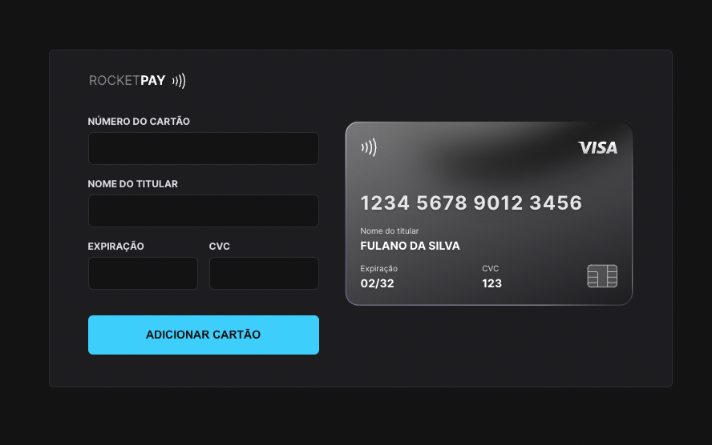

<p align="center">
  
</p>

<p align="center">
  
  
  <a href="https://rafaelfachinelli.com">
    
  </a>
  
</p>

<p align="center">
  <a href="#eye_speech_bubble-preview">Preview</a> •
  <a href="#information_source-about">About</a> •
  <a href="#memo-tasks">Tasks</a> •
  <a href="#arrow_forward-run">Run</a> •
  <a href="#hammer_and_wrench-technologies">Technologies</a> •
  <a href="#boy-author">Author</a> •
  <a href="#balance_scale-license">License</a>
</p>

---

## :eye_speech_bubble: Preview

<div align="center">

<kbd></kbd>

</div>

---

## :information_source: About

💳 A credit card form component: as you type, the card on the screen updates with the number, the name and the expiration date, and its colors and flag change between Visa, Mastercard and a default card. The inputs have masks made with iMask.

Built in 2022 at Rocketseat's Explorer Lab #01. Layout on [Figma](https://www.figma.com/file/gpqavL469k0pPUGOmAQEM9/Explorer-Lab-%2301/duplicate).

---

## :memo: Tasks

<div align="center">
<details>
<summary>Click to view</summary>

|State|Task|
|:---:|:---|
|:heavy_check_mark:|Card and form layout|
|:heavy_check_mark:|Input masks with iMask|
|:heavy_check_mark:|Card flag detection (Visa, Mastercard, default)|
|:heavy_check_mark:|Card updated through the DOM while typing|

</details>
</div>

---

## :arrow_forward: Run

You need [Node.js](https://nodejs.org/). In the project folder:

```bash
# Install dependencies
npm install

# Start the development server
npm run dev
```

> Vite prints the local address, usually <http://localhost:5173>.

---

## :hammer_and_wrench: Technologies

<div align="center">

|Web|
|:---:|
|[HTML5](https://developer.mozilla.org/en-US/docs/Web/HTML)|
|[CSS3](https://developer.mozilla.org/en-US/docs/Web/CSS)|
|[JavaScript](https://developer.mozilla.org/en-US/docs/Web/JavaScript)|
|[Vite](https://vite.dev/)|
|[iMask](https://imask.js.org/)|

</div>

---

## :boy: Author

<div align="center">

<a href="https://rafaelfachinelli.com">
  
  <br/>
  <sub><b>Rafael Fachinelli</b></sub>
</a>

Tech Lead and software engineer. Get in touch!

[](https://rafaelfachinelli.com)
[](https://www.linkedin.com/in/rafaelfachinelli/)
[](https://github.com/rafaelfachinelli)
[](mailto:contato@rafaelfachinelli.com)

</div>

---

## :balance_scale: License

This project is under the [MIT license](./LICENSE).
